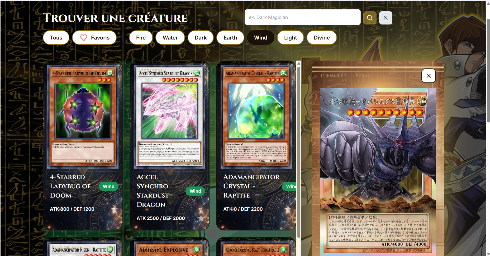

# Mon Dex connecté — Yu-Gi-Oh!

Dex connecté à l'API YGOPRODeck (https://db.ygoprodeck.com/api-guide/).
Site : [(lien GitHub Pages)](https://med00-co.github.io/sprint-3_brief-1_Dex-Connect-/)

## ScreenShoots


## Fonctionnalités
- Liste paginée (numéros de page), 20 cartes par page
- Filtre par attribut (requête API)
- Recherche par nom (fname) et bouton Effacer
- Détail d'une carte (requête dédiée)
- États : chargement, succès, vide, erreur avec bouton Réessayer
- Favoris (LocalStorage) et dernière recherche (SessionStorage)

## Fichiers
- `src/services/api.js` : appels API et transformation du JSON
- `src/storage.js` : LocalStorage et SessionStorage
- `src/ui.js` : affichage (cartes, détail, états, pagination)
- `src/main.js` : événements et coordination

## Lancer le projet
npm install, npm run dev, puis ouvrir index.html avec Live Server.

## Remarques
Pagination par numéros et filtre via l'API, à la demande du formateur.
Images : ygoprodeck.com.

## Auteur

Mohamed Id Irrami
```